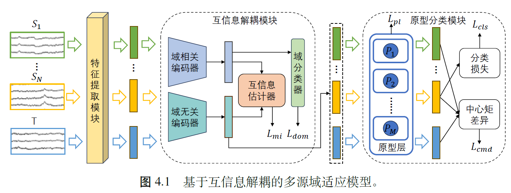

# 大论文总结

## 概述

重点研究脑电信号跨域识别中泛化性特征表示问题

跨被试和跨时段

互信息解耦模块利用两个编码器分别提取域相关特征和域无关特征，并通过互信息最小化来约束这两种特征尽可能分离。

使用原型分类方法

## 问题概述

跨被试：使用一组被试的数据训练模型，然后将训练好的模型应用于另一组被试的数据

跨时段：由于个体状态的不稳定性，同一被试在不同时段采集的脑电信号可能也存在差异性

域适应可以挖掘源域被试和目标域被试之间共同的被试无关特征，从而降低被试差异对跨域识别的影响

在脑电跨域识别中，源域通常由多个被试的数据组成，使得源域内的数据之间也存在分布差异。多源域适应

## 模型

特征提取模块将数据从原始输入空间映射到一个共享的特征空间，得到一个初始的特征表示 $f=FE(x)$

域相关编码器 $ENC^{re}(·)$、域无关编码器 $ENC^{unre}(·)$、互信息估计器 $MI(·)$、域分类器 $C^{dom}(·)$。

利用域分类器，分类不同源域和目标域的数据，让域相关编码器获得的域相关信息尽可能多

通过互信息最小化可以限制变量之间的依赖关系，使得域无关特征包含来自域相关特征的最小信息

$I(X; Y)$ 计算公式如下：

$$
I(X;Y ) = \mathbb{E}_{p(x, y)} \left[ \log \frac{p(x, y)}{p(x) p(y)} \right]
$$

其中：

*   $p(x, y)$ 表示联合分布。
*   $p(x)$ 和 $p(y)$ 分别是边际分布。

由于计算联合分布和边际分布之间的对数密度比比较复杂，实际应用中通常采用估计方法。文中使用了对比对数比上界（CLUB）来估计互信息，公式如下：

$$
I_{CLUB} = \mathbb{E}_{p(x, y)} \left[\log q_\theta(y | x) \right] - \mathbb{E}_{p(x)} \mathbb{E}_{p(y)} \left[\log q_\theta(y | x) \right]
$$

其中，$q_\theta(y | x)$ 是一个变分分布，用于近似真实分布 $p(y | x)$，并通过神经网络来学习这些参数。

引入原型学习对域无关特征进行分类。

$L_{cls}$ 通过交叉熵损失，优化样本与其对应类别原型之间的相似度，确保分类结果尽可能准确。

$L_{pl}$ 通过优化类别原型之间的距离，增强类别区分度，避免类别间的重叠，确保模型学到的类别原型具有良好的分隔性。

通过降低 CMD 损失来缩小每个源域和目标域之间的分布差异，从而更好地预测目标域。

## 实验

SEED 和 SEED-IV 数据集
