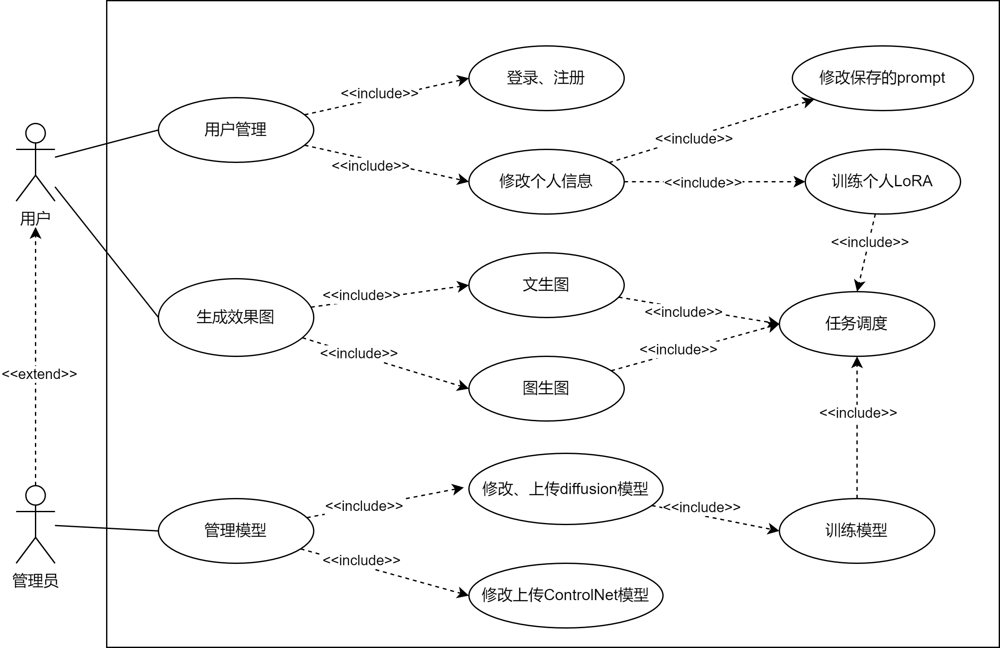
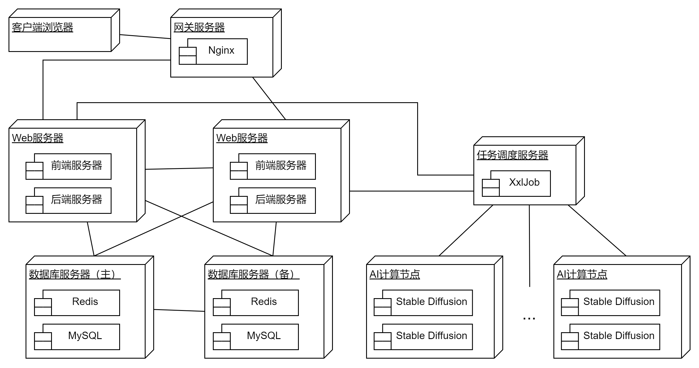
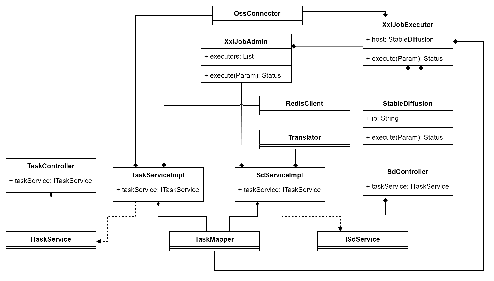
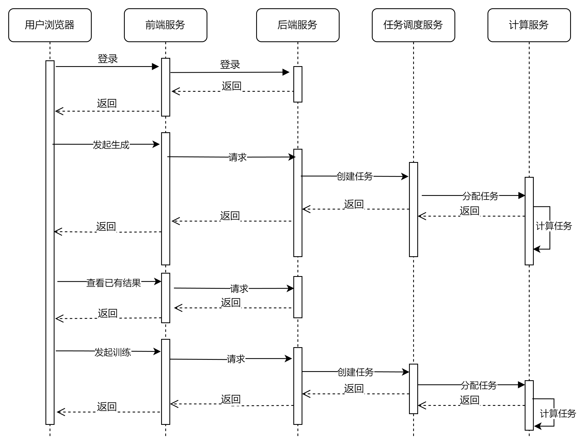
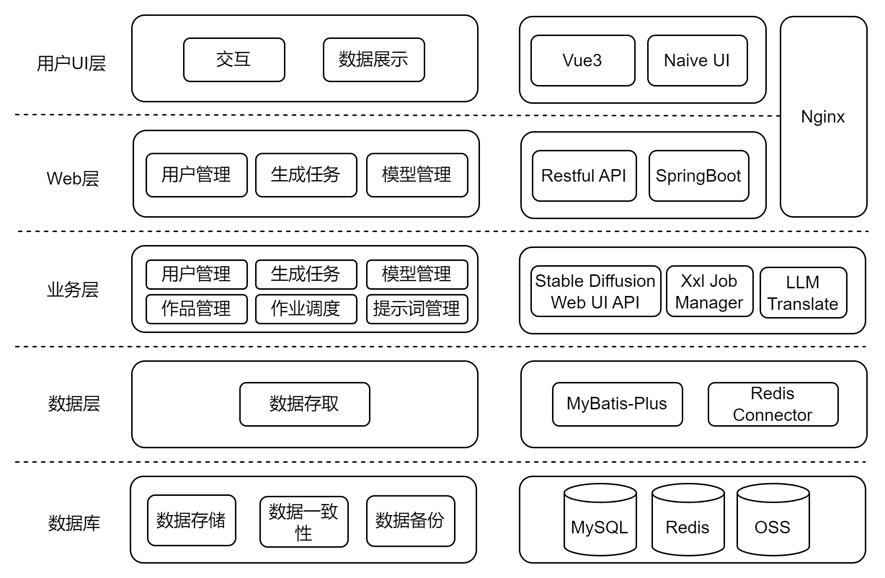

# NeurArch——AIGC智慧设计平台

## ppt模板

[上海大学](./课堂讨论讲解参考模板.pptx)

别的你自己找找

ppt放点图放点文字，算算时间

下面五张图你看看能不能加点颜色美化一下，感觉丑丑的

然后你看看怎么安排顺序

## 系统介绍

给建筑设计师使用的找灵感的平台

使用AIGC（Stable Diffusion）技术生成效果图

能够根据简单的提示词、设计师画的线稿图或设计师建模后的白模和风格图快速生成效果图

对生成后的图进行细化和重绘

前端使用Vue3，后端使用Springboot，连接Redis和MySQL数据库

## 具体功能

#### 用户登录注册、修改信息

#### 查看自己生成过的图片

左边

#### 高级功能-用户根据自己的作品训练属于自己的LoRA模型

#### AI文创

根据用户输入的提示词生成图片

在右边可以选择比例、建筑类型、风格元素

比例控制图片尺寸

不同建筑类型对应切换不同Stable Diffusion的大模型（checkpoint）

风格元素下的多选框：将所选的元素翻译成英文后拼接到用户输入的提示词后一起传给推理器

用户可选符合自己作品风格的LoRA模型

#### AI图创

功能同上，但加入了线稿或白模作为基础信息

将用户输入的草稿传给ControlNet，使用Canny边缘检测预处理器，嵌入Diffusion中

将用户输入的白模传给ControlNet，使用Depth深度信息预处理器嵌入Diffusion中

#### AI融合

功能同上，但加入了风格图作为色彩信息

将用户输入的风格图传给ControlNet，使用Style Ony预处理器嵌入Diffusion中

#### AI细化

将上述三种的输出结果进行细节重绘和超分辨率重绘

#### 管理员功能

修改、训练、上传不同建筑类型对应的Diffusion模型

修改、上传ControlNet模型

## 生成原理

用户给提示词，对提示词翻译

给图片，图片传OSS

生成记录存MySQL

参数一起传给XXl Job，Xxl Job创建一个执行器，对Stable Diffusion Web UI的机器轮询调度，有空就塞，没空硬塞

​	任务被调度执行时，Xxl Job Executor设状态running存Redis，设置过期时间

​	任务执行完成后，Xxl Job Executor保存图片，存Oss，数据存MySQL，删Redis

用户查询该任务时：

​	先查Redis，有且状态running，调用Stable Diffusion Web UI的progress api返回进度

​	否则查MySQL，根据状态error或success或pending返回信息

当初梳理的图

## 训练原理同上，只不过是节点显卡更强一点

## 场景视图

四个视图中的元素通过使业务场景视图或[用例图](https://zhida.zhihu.com/search?q=用例图&zhida_source=entity&is_preview=1)无缝地协同工作。业务场景在某种意义上是对最重要需求的抽象。场景视图在传统IT架构设计中是多余的(因此是“+1”) 。场景视图有两个主要目的：

- 作为在架构设计流程中发现架构元素的驱动因素和需求；
- 作为在此架构设计完成之后的验证。

这里使用UML用例图展示场景视图

## 物理视图

物理架构主要考虑了系统的非功能需求，如可用性、可靠性 (容错性) 、性能 (吞吐量) 和可伸缩性。软件在计算机网络或物理设施 (或简称节点) 上执行，确定的各种元素——网络、流程、任务和对象——需要映射到各个节点上。

节点使用不同的物理配置：一些用于开发和测试，另一些用于为不同的站点或不同的客户部署系统。因此，软件到节点的映射需要高度灵活，并对源代码本身的影响最小。

这里使用了UML的部署图展示物理视图

## 逻辑视图

逻辑视图主要支持功能需求，也就是系统应该为其用户提供的服务。系统被分解为一组关键抽象元素，这些抽象元素来自问题域，以对象或对象类的形式获取。对象利用了抽象、封装和继承的原则。这种分解不仅是为了进行[功能分析](https://zhida.zhihu.com/search?q=功能分析&zhida_source=entity&is_preview=1)，而且还可以用于识别在系统的各个部分之间的通用机制和设计元素。

这里使用UML的类图展现

SpringBoot的类图咋画啊这么多类。。

这里画出了关键的类图

## 进程视图

用来描述系统中的动态信息的

使用UML序列图描述

这里任务分配和计算是异步进行的，用户无需等待计算运行，可在后续查看结果

## 开发视图

每个子系统仅仅能与同层或更低层的子系统通讯，这样可以使每个层次的接口既完备又精练，避免了各个模块之间很复杂的依赖关系。

设计时要充分考虑，对于各个层次，层次越低，通用性越强，这样，可以保证应用程序的需求发生改变时，所做的改动最小。开发视图所用的风格通常是层次结构风格。

这里使用5层子系统

