# 说说 Java 中 HashMap 的原理？ - 面试鸭 | 2026最新Java 热门面试题 200 道+详细答案解析

## 回答重点

HashMap 底层就是一个**数组**，结合**链表**和**红黑树**来解决冲突。

它的工作原理其实很简单，主要说这 3 点:

1）怎么存

存一个 Key-Value 时，先算 Key 的 hashCode，然后用 `(table.length-1) & hash` 算出应该放在数组的哪个下标位置。

2）冲突了怎么办

两个不同的 Key 算出来下标一样，就叫哈希冲突。HashMap 的解决办法是用链表把它们串起来，JDK 8 做了优化，如果同一个下标下的链表超过 8 个节点（且数组长度大于等于 64），就转成红黑树，查找速度从 O(n) 变成 O(logn)。

3）扩容机制

数组长度是有限的，存多了会挤。HashMap 有个负载因子默认 0.75，数组用了 75% 就自动扩容，把数组大小翻倍，然后把所有数据重新算位置放到新数组里。这个操作叫 rehash，比较耗性能，所以初始化时最好给个预估容量。

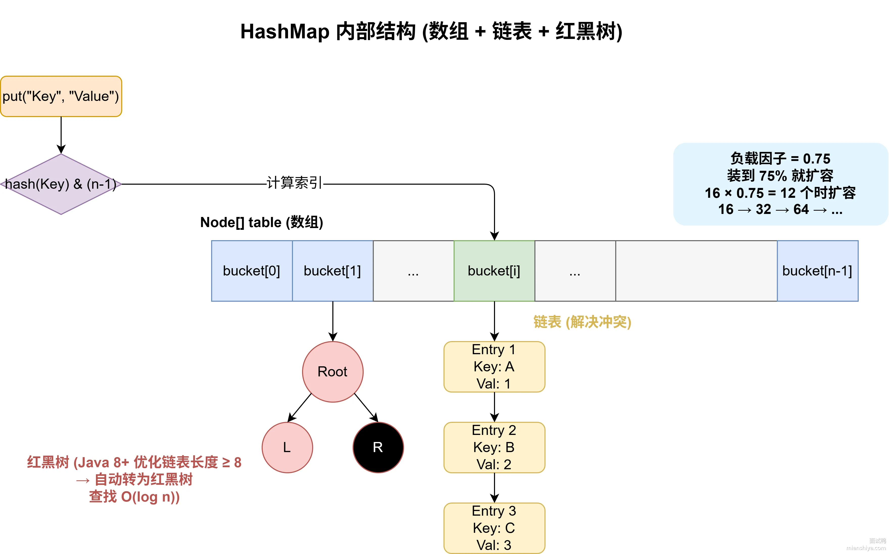

注意 HashMap 是非线程安全的，多线程环境下可能出问题，比如数据覆盖或者死循环，这时候应该用 ConcurrentHashMap。

**总结一下就是**：HashMap 底层是数组加链表，Java 8 引入了红黑树优化。存取时通过哈希算法定位下标，遇到冲突就用链表或红黑树解决。为了保证性能，达到阈值会扩容。

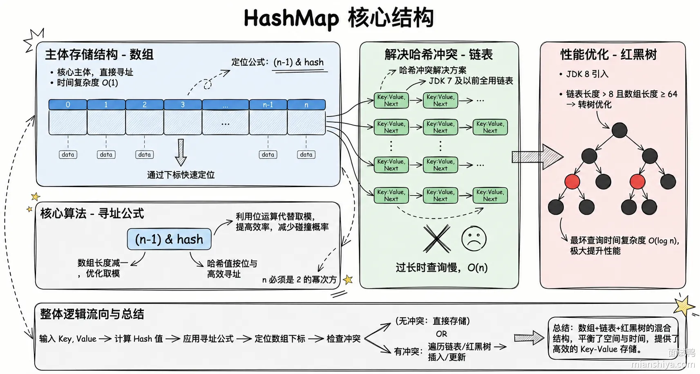

## 扩展知识

### HashMap 的扩容机制

- [Java 中 HashMap 的扩容机制是怎样的？ ](https://www.mianshiya.com/question/1780933294750199809)

### 红黑树优化

JDK 8 引入红黑树是为了解决哈希冲突严重时的性能问题。当多个元素映射到同一个桶，链表会越来越长，查找效率从 O(1) 退化到 O(n)。红黑树是一种自平衡二叉搜索树，能把最坏情况下的查找复杂度控制在 O(logn)。

转换阈值：**链表长度超过 8 且数组长度大于等于 64 时转红黑树**；树中节点少于 6 时退化回链表。

为什么是 8 和 6？留了个缓冲区间，避免在临界点反复转换。

### hashCode 和 equals 的重要性

HashMap 的 key 必须正确实现 hashCode() 和 equals() 方法。hashCode() 决定元素存在哪个桶，equals() 决定两个 key 是不是同一个。

put 的时候，如果两个 key 的 hashCode() 相同但 equals() 返回 false，它们会被当成不同的 key 存在同一个桶的不同位置。如果 hashCode() 实现得不好导致分布不均，或者 equals() 写错了，会导致元素找不到或者重复插入。

- [428. Java 中的 hashCode 和 equals 方法之间有什么关系？](https://www.mianshiya.com/question/1780933294574039042)

### 默认容量和负载因子

默认容量 16，负载因子 0.75，这个组合是性能和空间的平衡点。负载因子高了省空间但冲突多，低了冲突少但浪费内存。如果已知要存多少数据，建议提前设定初始容量，比如要存 100 个元素，初始容量设成 `(int)(100/0.75f)+1` 能避免扩容。

### 哈希冲突链表法图解

存键值对时，根据 hash 算法计算 key 的 hash 值，然后 `(n-1) & hash` 得到数组下标，把键值对塞到那个位置。

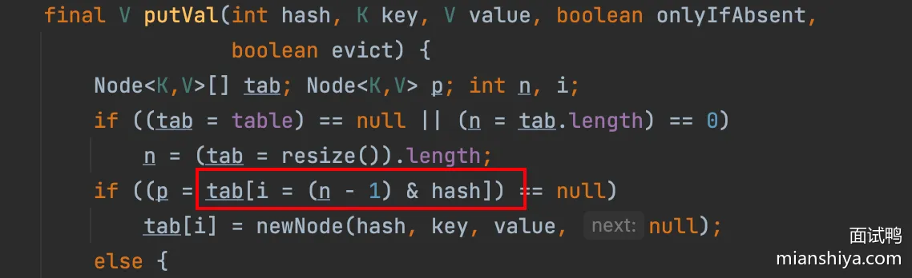

hash 算法可能产生冲突，数组大小也有限，不同的 key 可能算出一样的下标，所以用链表法解决冲突：

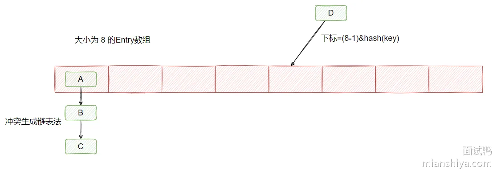

### JDK 7 头插法的死循环问题

JDK 7 及以前链表插入用的是头插法，新节点插到链表头部。多线程环境下，并发扩容时可能导致链表成环，程序卡死。

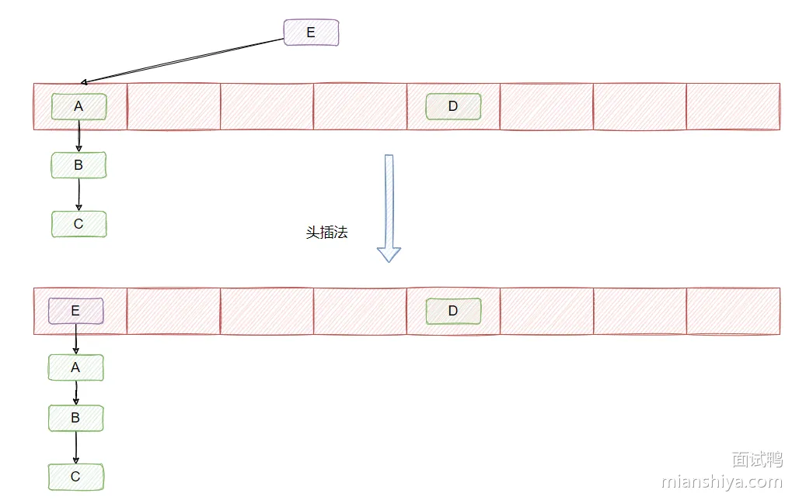

举个例子，假设线程 1 和 2 同时触发扩容：

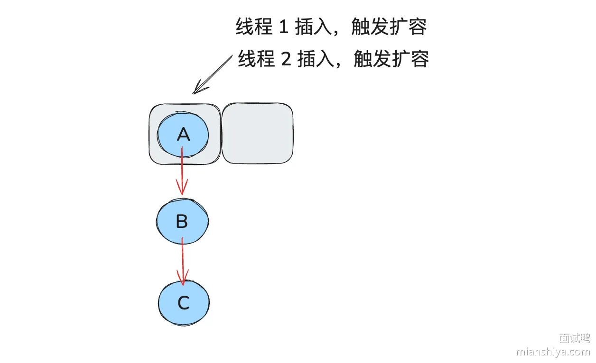

```java
void transfer(Entry[] newTable) {
  Entry[] src = table;
  int newCapacity = newTable.length;
  for (int j = 0; j < src.length; j++) {
      Entry<K,V> e = src[j];
      if (e != null) {
          src[j] = null;
          do {
              Entry<K,V> next = e.next;
             int i = indexFor(e.hash, newCapacity);//线程1执行到这没cpu时间片，线程2继续执行
             e.next = newTable[i];
             newTable[i] = e;
             e = next;
         } while (e != null);
     }
 }
}
```

假设线程 1 中 e 是 A，next 为 B，刚要开始搬运，时间片到了，停在上面注释那一行。

线程 2 开始扩容并完成：

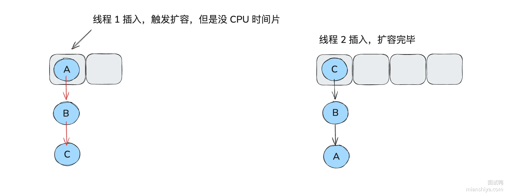

线程 2 完成后，线程 1 得到时间片继续执行，它开始执行以下代码：

```java
e.next = newTable[i];  // A.next = null
newTable[i] = e;
e = next;
```

线程 1 的 newTable 是新建的，上面还没数据，所以 A.next 为 null，A 被放到数组上，e 变成 B。

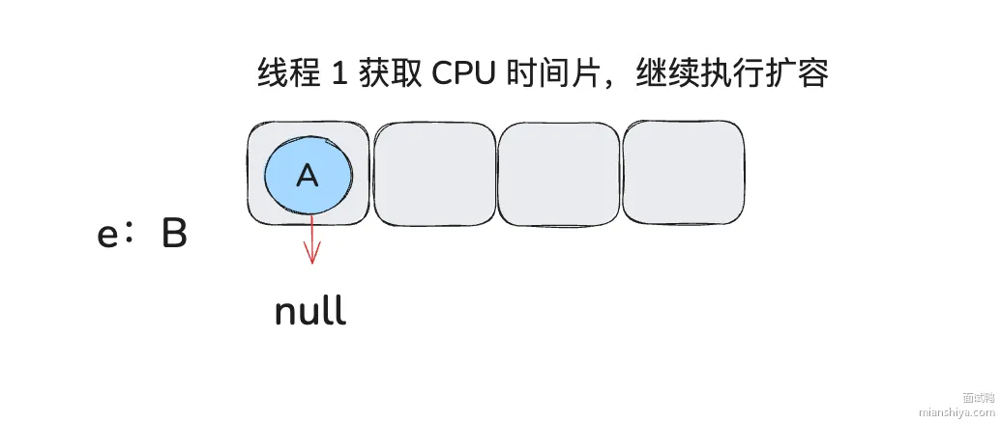

继续执行（看注释）：

```java
  do {
     Entry<K,V> next = e.next;  // e 为 B，e.next 为 A
     int i = indexFor(e.hash, newCapacity);
     e.next = newTable[i]; // B.next = A
     newTable[i] = e;  // newTable[i] = B
     e = next;        // e = A
 } while (e != null);
```

由于线程 2 的操作，e.next 已经变成了 A：

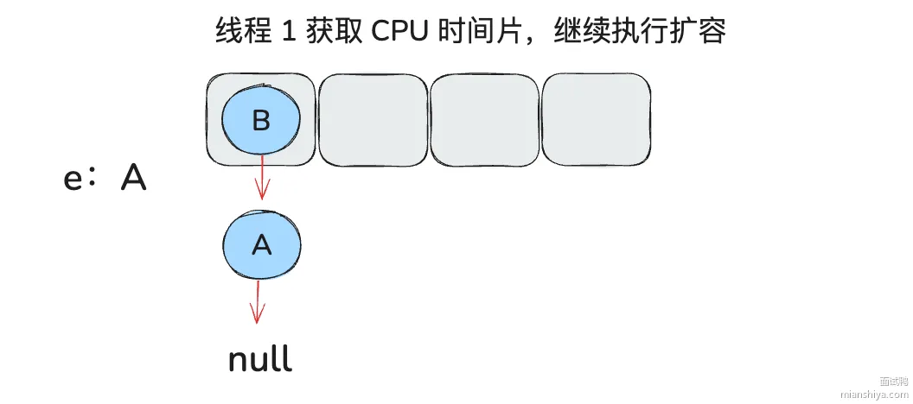

由于 `e != null`，继续循环：

```java
  do {
     Entry<K,V> next = e.next;  // e 为 A，e.next 为 null
     int i = indexFor(e.hash, newCapacity);
     e.next = newTable[i]; // A.next = B
     newTable[i] = e;  // newTable[i] = A
     e = next;        // e = null
 } while (e != null); // e == null 跳出循环，此时成环
```

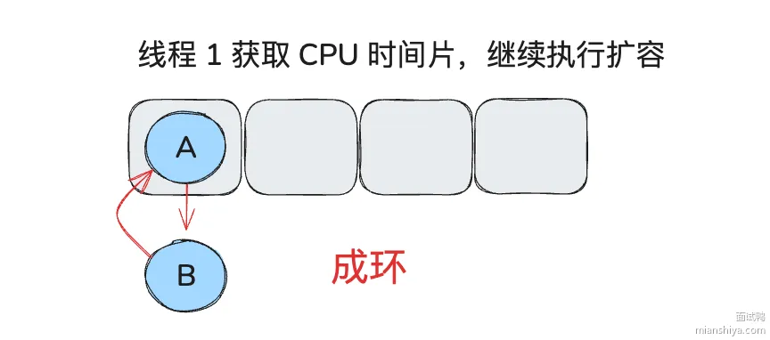

JDK 8 改成了尾插法，新节点插到链表尾部，保持插入顺序，避免了成环问题。

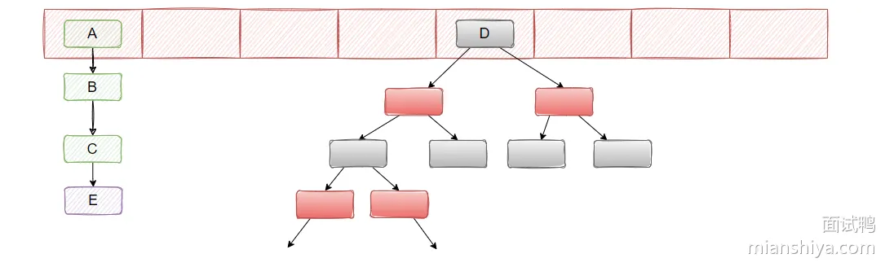

并且引入红黑树，链表长度大于等于 8 且数组大小大于等于 64 时转红黑树，红黑树节点小于 6 时退化回链表。

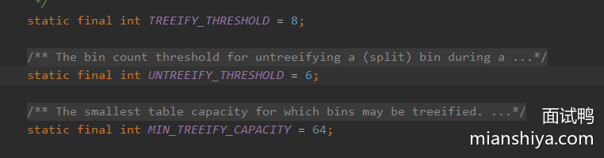

## 面试官追问

#### 提问：为什么链表转红黑树的阈值是 8，不是 6 或者 10？

>

详细解答可以看：[为什么 JDK 1.8 对 HashMap 进行了红黑树的改动？](https://www.mianshiya.com/question/1780933294771171329)

回答：根据泊松分布计算，在负载因子 0.75 的情况下，一个桶里元素个数达到 8 的概率已经非常低了，大概是千万分之六。选 8 是因为这个概率下转红黑树基本只会在 hash 分布极差的时候发生，正常情况几乎不会触发，既保证了极端情况的性能，又避免了频繁转换的开销。

#### 提问：JDK 8 改成尾插法就完全线程安全了吗？

回答：没有。尾插法只是解决了扩容时链表成环的问题，但 HashMap 本身还是非线程安全的。并发 put 的时候还是可能丢数据，比如两个线程同时往一个空桶插入，后插入的会覆盖先插入的。多线程场景必须用 ConcurrentHashMap。

#### 提问：HashMap 的 key 可以用 null 吗？

回答：可以，HashMap 允许一个 null key。存的时候会把 null key 的 hash 值当成 0，固定放在数组下标 0 的位置。但 ConcurrentHashMap 不允许 null key，因为多线程场景下无法区分"key 不存在"和"key 存在但 value 是 null"。
