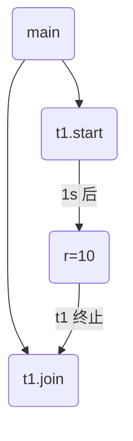
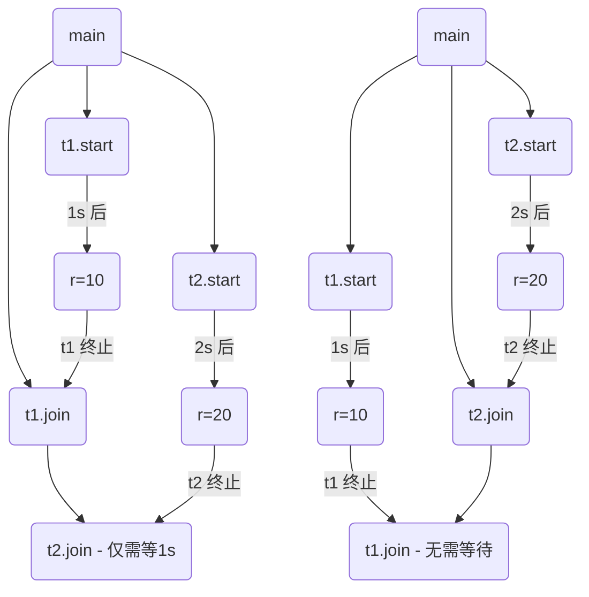
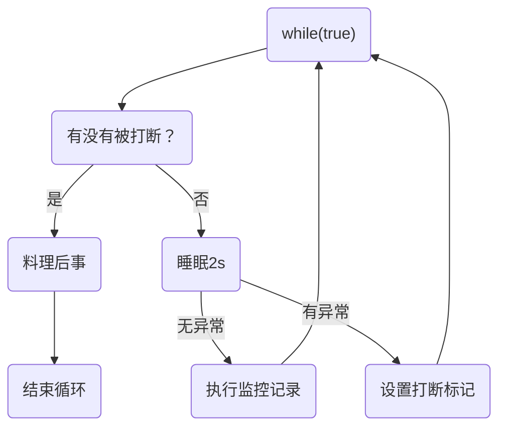
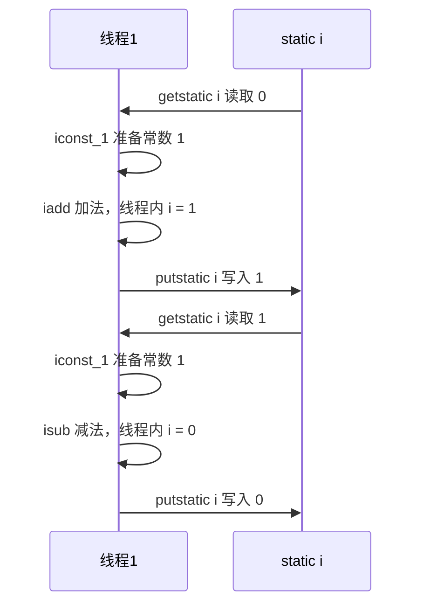
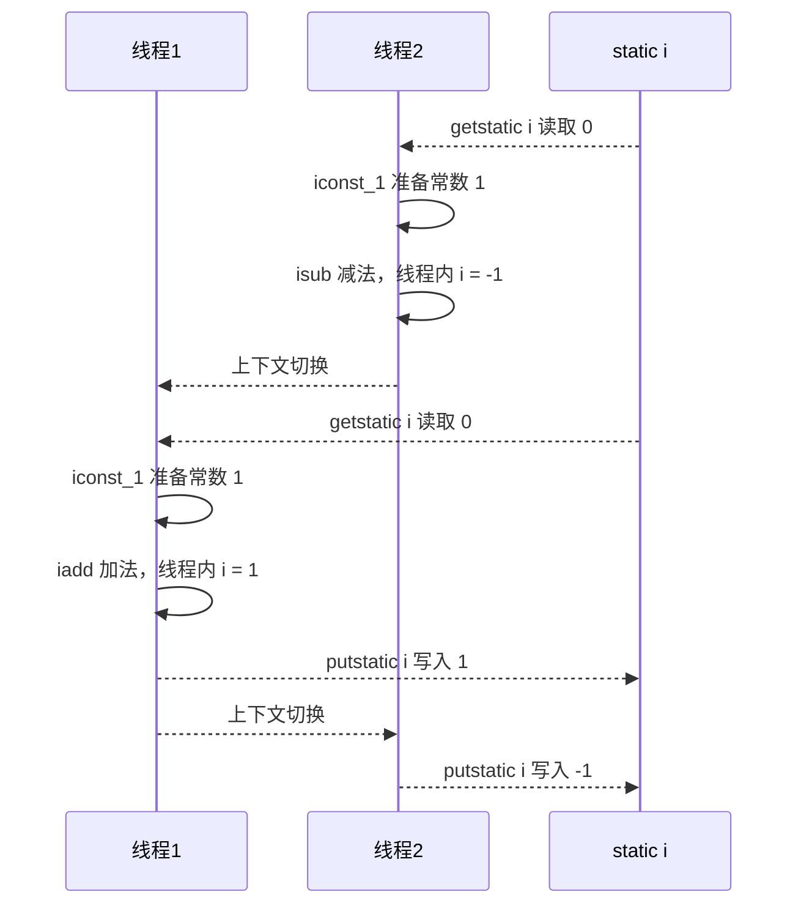
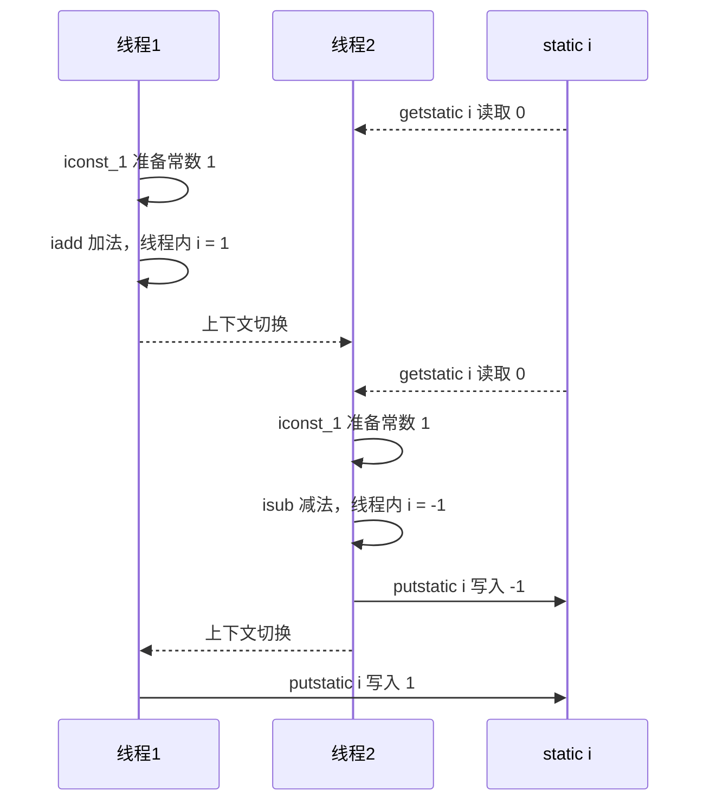
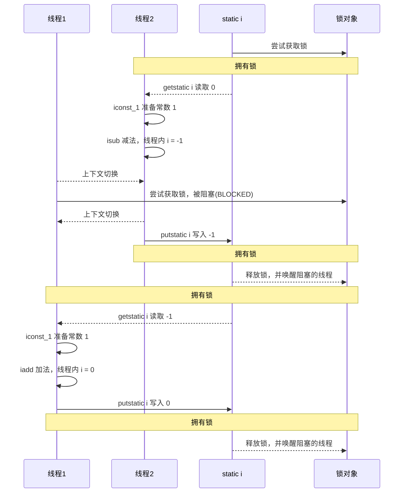

# Java 并发编程

## 准备

### `pom.xml` 依赖如下

```xml
<properties>
    <project.build.sourceEncoding>UTF-8</project.build.sourceEncoding>
      <maven.compiler.source>1.8</maven.compiler.source>
      <maven.compiler.target>1.8</maven.compiler.target>
  </properties>

  <dependencies>
    <dependency>
      <groupId>junit</groupId>
      <artifactId>junit</artifactId>
      <version>4.11</version>
      <scope>test</scope>
    </dependency>
    <!-- https://mvnrepository.com/artifact/org.projectlombok/lombok -->
    <dependency>
      <groupId>org.projectlombok</groupId>
      <artifactId>lombok</artifactId>
      <version>1.18.22</version>
      <scope>provided</scope>
    </dependency>
    <dependency>
      <groupId>org.slf4j</groupId>
      <artifactId>slf4j-api</artifactId>
      <version>1.7.22</version>
    </dependency>
    <dependency>
      <groupId>ch.qos.logback</groupId>
      <artifactId>logback-classic</artifactId>
      <version>1.2.3</version>
    </dependency>
    <dependency>
      <groupId>org.junit.jupiter</groupId>
      <artifactId>junit-jupiter</artifactId>
      <version>RELEASE</version>
      <scope>compile</scope>
    </dependency>
  </dependencies>
```

### `logback.xml` 配置如下

```xml
<?xml version="1.0" encoding="UTF-8"?>
<configuration scan="true">
    <appender name="STDOUT" class="ch.qos.logback.core.ConsoleAppender">
        <encoder>
            <pattern>%date{HH:mm:ss} [%t] %logger - %m%n</pattern>
        </encoder>
    </appender>
    <logger name="c" level="debug" additivity="false">
        <appender-ref ref="STDOUT"/>
    </logger>
    <root level="ERROR">
        <appender-ref ref="STDOUT"/>
    </root>
</configuration>
```

## 进程与线程

### 进程与线程

#### 进程 

- 程序由指令和数据组成，但这些指令要运行，数据要读写，就必须将指令加载至 CPU，数据加载至内存。在 指令运行过程中还需要用到磁盘、网络等设备。进程就是用来加载指令、管理内存、管理 IO 的 。
- 当一个程序被运行，从磁盘加载这个程序的代码至内存，这时就开启了一个进程。 
- 进程就可以视为程序的一个实例。大部分程序可以同时运行多个实例进程（例如记事本、画图、浏览器 等），也有的程序只能启动一个实例进程（例如网易云音乐、360 安全卫士等）

#### 线程 

- 一个进程之内可以分为一到多个线程。 


- 一个线程就是一个指令流，将指令流中的一条条指令以一定的顺序交给 CPU 执行 


- Java 中，线程作为最小调度单位，进程作为资源分配的最小单位。 在 Windows 中进程是不活动的，只是作 为线程的容器


#### 二者对比 

- 进程基本上相互独立的，而线程存在于进程内，是进程的一个子集 


- 进程拥有共享的资源，如内存空间等，供其内部的线程共享 


- 进程间通信较为复杂 
  - 同一台计算机的进程通信称为 IPC（Inter-process communication） 
  - 不同计算机之间的进程通信，需要通过网络，并遵守共同的协议，例如 HTTP 

- 线程通信相对简单，因为它们共享进程内的内存，一个例子是多个线程可以访问同一个共享变量 


- 线程更轻量，线程上下文切换成本一般上要比进程上下文切换低


### 并行与并发

单核 CPU下，线程实际还是**串行执行**的。操作系统中有一个组件叫做任务调度器，将 CPU 的时间片（windows 下时间片最小约为 15 毫秒）分给不同的程序使用，只是由于 CPU 在线程间（时间片很短）的切换非常快，人类感觉是同时运行的 。总结为一句话就是： **微观串行，宏观并行** 。 

一般会将这种线程轮流使用 CPU 的做法称为并发，concurrent

| CPU  | 时间片 1 | 时间片 2 | 时间片 3 | 时间片 4 |
| :--: | :------: | :------: | :------: | :------: |
| core |  线程 1  |  线程 2  |  线程 3  |  线程 4  |

多核 CPU 下，每个 核（core） 都可以调度运行线程，这时候线程可以是并行的。

|  CPU  | 时间片 1 | 时间片 2 | 时间片 3 | 时间片 4 |
| :---: | :------: | :------: | :------: | :------: |
| core1 |  线程 1  |  线程 2  |  线程 3  |  线程 4  |
| core2 |  线程 4  |  线程 4  |  线程 2  |  线程 2  |

引用 Rob Pike 的一段描述： 

- 并发（concurrent）是同一时间应对（dealing with）多件事情的能力。
- 并行（parallel）是同一时间动手做（doing）多件事情的能力。

### 应用 

#### 应用之异步调用

以调用方角度来讲

* 如果需要等待结果返回，才能继续运行就是同步 
* 不需要等待结果返回，就能继续运行就是异步 

**设计** 

多线程可以让方法执行变为异步的（即不要巴巴干等着）、比如说读取磁盘文件时，假设读取操作花费了 5 秒钟，如果没有线程调度机制，这 5 秒 CPU 什么都做不了，其它代码都得暂停... 

**结论** 

- 比如在项目中，视频文件需要转换格式等操作比较费时，这时开一个新线程处理视频转换，避免阻塞主线程
-  Tomcat 的异步 Servlet 也是类似的目的，让用户线程处理耗时较长的操作，避免阻塞 Tomcat 的工作线程
- UI 程序中，开线程进行其他操作，避免阻塞 UI 线程

#### 应用之提高效率

充分利用多核 CPU 的优势，提高运行效率。想象下面的场景，执行 3 个计算，最后将计算结果汇总。

```
计算 1 花费 10 ms
计算 2 花费 11 ms
计算 3 花费 9 ms
汇总需要 1 ms
```

- 如果是串行执行，那么总共花费的时间是 10 + 11 + 9 + 1 = 31ms 

- 但如果是四核 CPU，各个核心分别使用线程 1 执行计算 1，线程 2 执行计算 2，线程 3 执行计算 3，那么 3 个 线程是并行的，花费时间只取决于最长的那个线程运行的时间，即 11ms 最后加上汇总时间只会花费 12ms

> **注意**
>
> 需要在多核 CPU 才能提高效率，单核仍然时是轮流执行

**设计** 

>代码见【应用之效率-案例1】

**结论**

1. 单核 CPU 下，多线程不能实际提高程序运行效率，只是为了能够在不同的任务之间切换，不同线程轮流使用 CPU ，不至于一个线程总占用 CPU，别的线程没法干活
2. 多核 CPU 可以并行跑多个线程，但能否提高程序运行效率还是要分情况的
   - 有些任务，经过精心设计，将任务拆分，并行执行，当然可以提高程序的运行效率。但不是所有计算任 务都能拆分（参考后文的【阿姆达尔定律】）
   - 也不是所有任务都需要拆分，任务的目的如果不同，谈拆分和效率没啥意义
3. IO 操作不占用 CPU，只是我们一般拷贝文件使用的是【阻塞 IO】，这时相当于线程虽然不用 CPU，但需要一 直等待 IO 结束，没能充分利用线程。所以才有后面的【非阻塞 IO】和【异步 IO】优化。

## Java 线程

### 创建和运行线程 

#### 直接使用 `Thread`

```java
// 创建线程对象
Thread t = new Thread() {
    public void run() {
        // 要执行的任务
    }
};
// 启动线程
t.start();
```

例如

```java
// 构造方法的参数是给线程指定名字，推荐
Thread t1 = new Thread("t1") {
    @Override
    // run 方法内实现了要执行的任务
    public void run() {
        log.debug("hello");
    }
};
t1.start();
```

输出

```
19:19:00 [t1] c.ThreadStarter - hello
```

#### 使用 `Runnable` 配合 `Thread`

把【线程】和【任务】（要执行的代码）分开

- `Thread` 代表线程
- `Runnable` 可运行的任务（线程要执行的代码）

```java
Runnable runnable = new Runnable() {
    public void run(){
        // 要执行的任务
    }
};
// 创建线程对象
Thread t = new Thread( runnable );
// 启动线程
t.start(); 
```

例如

```java
// 创建任务对象
Runnable task2 = new Runnable() {
    @Override
    public void run() {
        log.debug("hello");
    }
};
// 参数1 是任务对象; 参数2 是线程名字，推荐
Thread t2 = new Thread(task2, "t2");
t2.start();
```

输出

```
9:19:00 [t2] c.ThreadStarter - hello
```

Java 8 以后可以使用 lambda 精简代码

```java
// 创建任务对象
Runnable task2 = () -> log.debug("hello");
// 参数1 是任务对象; 参数2 是线程名字，推荐
Thread t2 = new Thread(task2, "t2");
t2.start();
```

**`Thread` 与 `Runnable` 的关系** 

分析 `Thread` 的源码，理清它与 `Runnable` 的关系

```java
//Runnable源码
public interface Runnable {
    public abstract void run();
}
//Thread源码（部分）
public class Thread implements Runnable {
    /* What will be run. */
    private Runnable target;
    
    public Thread(Runnable target) {
        init(null, target, "Thread-" + nextThreadNum(), 0);
    }
    
    private void init(ThreadGroup g, Runnable target, String name,
                      long stackSize, AccessControlContext acc,
                      boolean inheritThreadLocals) {
        //...
        this.target = target;
       //...
    }
    @Override
    public void run() {
        if (target != null) {
            target.run();
        }
    }
```

**小结** 

- 方法 1 是把线程和任务合并在了一起，方法 2 是把线程和任务分开了 
- 用 `Runnable` 更容易与线程池等高级 API 配合 
- 用 `Runnable` 让任务类脱离了 `Thread` 继承体系，更灵活

#### `FutureTask` 配合 `Thread`

`FutureTask` 能够接收 `Callable` 类型的参数，用来处理有返回结果的情况

```java
// 创建任务对象
FutureTask<Integer> task3 = new FutureTask<>(() -> {
    log.debug("hello");
    return 100;
});
// 参数1 是任务对象; 参数2 是线程名字，推荐
new Thread(task3, "t3").start();
// 主线程阻塞，同步等待 task 执行完毕的结果
Integer result = task3.get();
log.debug("结果是:{}", result);
```

输出

```
19:22:27 [t3] c.ThreadStarter - hello
19:22:27 [main] c.ThreadStarter - 结果是:100
```

源码分析

```java
//FutureTask源码（部分）
public class FutureTask<V> implements RunnableFuture<V> {
    /** The underlying callable; nulled out after running */
    private Callable<V> callable;
    
    /** The result to return or exception to throw from get() */
    private Object outcome; // non-volatile, protected by state reads/writes
    
    public FutureTask(Callable<V> callable) {
        if (callable == null)
            throw new NullPointerException();
        this.callable = callable;
        this.state = NEW;       // ensure visibility of callable
    }
    
    public void run() {
       //...
        try {
            Callable<V> c = callable;
            if (c != null && state == NEW) {
                V result;
                boolean ran;
                try {
                    result = c.call();
                    ran = true;
                } catch (Throwable ex) {
                    result = null;
                    ran = false;
                    setException(ex);
                }
                if (ran)
                    set(result);
            }
        }
        //...
    }
    
    protected void set(V v) {
        if (UNSAFE.compareAndSwapInt(this, stateOffset, NEW, COMPLETING)) {
            outcome = v;
            UNSAFE.putOrderedInt(this, stateOffset, NORMAL); // final state
            finishCompletion();
        }
    }
    
    public V get() throws InterruptedException, ExecutionException {
        int s = state;
        if (s <= COMPLETING)
            s = awaitDone(false, 0L);
        return report(s);
    }
    
    private V report(int s) throws ExecutionException {
        Object x = outcome;
        if (s == NORMAL)
            return (V)x;
        if (s >= CANCELLED)
            throw new CancellationException();
        throw new ExecutionException((Throwable)x);
    }
}    
//Callable源码
@FunctionalInterface
public interface Callable<V> {
    /**
     * Computes a result, or throws an exception if unable to do so.
     *
     * @return computed result
     * @throws Exception if unable to compute a result
     */
    V call() throws Exception;
}
```

说明：

- `FutureTask` 内置了一个 `Callable` 对象，初始化方法将指定的 `Callable` 赋给这个对象。
- `FutureTask` 实现了 `Runnable` 接口，并重写了 `run` 方法，在 `run` 方法中调用了 `Callable` 中的 `call` 方法，并将返回值赋值给 `outcome` 变量
- `get` 方法就是取出 `outcome` 的值。

### 观察多个线程同时运行 

#### 主要是理解 

- 交替执行 
- 谁先谁后，不由我们控制

#### 示例代码

```java
@Slf4j(topic = "c.TestMultiThread")
public class TestMultiThread {
    public static void main(String[] args) {
        new Thread(() -> {
            while(true) {
                log.debug("running");
            }
        },"t1").start();
        new Thread(() -> {
            while(true) {
                log.debug("running");
            }
        },"t2").start();
    }
}
```

#### 运行结果

```sh
23:45:26.254 c.TestMultiThread [t2] - running
23:45:26.254 c.TestMultiThread [t2] - running
23:45:26.254 c.TestMultiThread [t2] - running
23:45:26.254 c.TestMultiThread [t2] - running
23:45:26.254 c.TestMultiThread [t1] - running
23:45:26.254 c.TestMultiThread [t1] - running
23:45:26.254 c.TestMultiThread [t1] - running
23:45:26.254 c.TestMultiThread [t1] - running
23:45:26.254 c.TestMultiThread [t1] - running
23:45:26.254 c.TestMultiThread [t1] - running
```

### 查看进程线程的方法 

#### Windows

- 任务管理器可以查看进程和线程数，也可以用来杀死进程 
- `tasklist` 查看进程 
  - `tasklist` | `findstr` (查找关键字)
- `taskkill` 杀死进程
  - `taskkill /F（彻底杀死）/PID（进程PID）`

#### Linux

- `ps -fe` 查看所有进程 
- `ps -fT -p`  查看某个进程（PID）的所有线程 
- `kill` 杀死进程
- `top` 按大写 H 切换是否显示线程 
- `top -H -p`  查看某个进程（PID）的所有线程

#### Java

- `jps` 命令查看所有 Java 进程 
- `jstack`  查看某个 Java 进程（PID）的所有线程状态 
- `jconsole` 来查看某个 Java 进程中线程的运行情况（图形界面）

`jconsole` 远程监控配置 

- 需要以如下方式运行你的 java 类

  ```sh
  java -Djava.rmi.server.hostname=`ip地址` -Dcom.sun.management.jmxremote -
  Dcom.sun.management.jmxremote.port=`连接端口` -Dcom.sun.management.jmxremote.ssl=是否安全连接 -
  Dcom.sun.management.jmxremote.authenticate=是否认证 java类
  ```

- 关闭防火墙，允许端口

- 修改 `/etc/hosts` 文件将 `127.0.0.1` 映射至主机名 

如果要认证访问，还需要做如下步骤 

- 复制 `jmxremote.password` 文件 
- 修改 `jmxremote.password` 和 `jmxremote.access` 文件的权限为 `600` 即文件所有者可读写 
- 连接时填入 `controlRole`（用户名），`R&D`（密码）

### 原理之线程运行

#### 栈与栈帧

Java Virtual Machine Stacks（Java 虚拟机栈） 

我们都知道 JVM 中由堆、栈、方法区所组成，其中栈内存是给谁用的呢？其实就是线程，每个线程启动后，虚拟 机就会为其分配一块栈内存。 

- 每个栈由多个栈帧（Frame）组成，对应着每次方法调用时所占用的内存 
- 每个线程只能有一个活动栈帧，对应着当前正在执行的那个方法

#### 线程上下文切换（Thread Context Switch）

因为以下一些原因导致 CPU 不再执行当前的线程，转而执行另一个线程的代码 

- 线程的 CPU 时间片用完 
- 垃圾回收 
- 有更高优先级的线程需要运行 
- 线程自己调用了 `sleep`、`yield`、`wait`、`join`、`park`、`synchronized`、`lock` 等方法 

当 Context Switch 发生时，需要由操作系统保存当前线程的状态，并恢复另一个线程的状态，Java 中对应的概念就是程序计数器（Program Counter Register），它的作用是记住下一条 JVM 指令的执行地址，是线程私有的 

- 状态包括程序计数器、虚拟机栈中每个栈帧的信息，如局部变量、操作数栈、返回地址等 
- Context Switch 频繁发生会影响性能

### 常见方法

| 方法                                            | 功能                                                         | 说明                                                         |
| ----------------------------------------------- | ------------------------------------------------------------ | ------------------------------------------------------------ |
| **public void start()**                         | 启动一个新线程；Java 虚拟机调用此线程的 run 方法             | start 方法只是让线程进入就绪，里面代码不一定立刻 运行（CPU 的时间片还没分给它）。每个线程对象的 start 方法只能调用一次，如果调用了多次会出现 IllegalThreadStateException |
| **public void run()**                           | 线程启动后调用该方法                                         | 如果在构造 Thread 对象时传递了 Runnable 参数，则 线程启动后会调用 Runnable 中的 run 方法，否则默 认不执行任何操作。但可以创建 Thread 的子类对象，来覆盖默认行为 |
| **public void setName(String name)**            | 给当前线程取名字                                             |                                                              |
| **public void getName()**                       | 获取当前线程的名字。线程存在默认名称：子线程 Thread 索引，主线程是 main |                                                              |
| **public static Thread currentThread()**        | 获取当前线程对象，代码在哪个线程中执行                       |                                                              |
| **public static void sleep(long time)**         | 让当前线程休眠多少毫秒再继续执行。**Thread.sleep(0)**：让操作系统立刻重新进行一次 CPU 竞争 |                                                              |
| **public static native void yield()**           | 提示线程调度器让出当前线程对 CPU 的使用                      | 主要是为了测试和调试                                         |
| **public final int getPriority()**              | 返回此线程的优先级                                           |                                                              |
| **public final void setPriority(int priority)** | 更改此线程的优先级，常用 1 5 10                              | java 中规定线程优先级是 1~10 的整数，较大的优先级 能提高该线程被 CPU 调度的机率 |
| **public void interrupt()**                     | 中断这个线程，异常处理机制                                   |                                                              |
| **public static boolean interrupted()**         | 判断当前线程是否被打断，清除打断标记                         |                                                              |
| **public boolean isInterrupted()**              | 判断当前线程是否被打断，不清除打断标记                       |                                                              |
| **public final void join()**                    | 等待这个线程结束                                             |                                                              |
| **public final void join(long millis)**         | 等待这个线程死亡millis毫秒，0意味着永远等待                  |                                                              |
| **public final native boolean isAlive()**       | 线程是否存活（还没有运行完毕）                               |                                                              |
| **public final void setDaemon(boolean on)**     | 将此线程标记为守护线程或用户线程                             |                                                              |
| **public long getId()**                         | 获取线程长整型的 id                                          | id 唯一                                                      |
| **public state getState()**                     | 获取线程状态                                                 | Java 中线程状态是用 6 个 enum 表示，分别为： NEW，RUNNABLE，BLOCKED，WAITING，TIMED_WAITING，TERMINATED |
| **public boolean isInterrupted()**              | 判断是否被中断                                               | 不会清除打断标记                                             |

### `start` 与 `run` 

#### 调用 `run`

```java
public static void main(String[] args) {
    Thread t1 = new Thread("t1") {
        @Override
        public void run() {
            log.debug(Thread.currentThread().getName());
            FileReader.read(Constants.MP4_FULL_PATH);
        }
    };
    t1.run();
    log.debug("do other things ...");
}
```

输出

```sh
19:39:14 [main] c.TestStart - main
19:39:14 [main] c.FileReader - read [1.mp4] start ...
19:39:18 [main] c.FileReader - read [1.mp4] end ... cost: 4227 ms
19:39:18 [main] c.TestStart - do other things ...
```

程序仍在 `main` 线程运行，`FileReader.read()` 方法调用还是同步的

#### 调用 `start`

将上述代码的 `t1.run()` 改为

```java
t1.start();
```

输出

```sh
19:41:30 [main] c.TestStart - do other things ...
19:41:30 [t1] c.TestStart - t1
19:41:30 [t1] c.FileReader - read [1.mp4] start ...
19:41:35 [t1] c.FileReader - read [1.mp4] end ... cost: 4542 ms
```

程序在 `t1` 线程运行，`FileReader.read()` 方法调用是异步的

#### 小结 

- 直接调用 `run` 是在主线程中执行了 `run`，没有启动新的线程 

- 使用 `start` 是启动新的线程，通过新的线程间接执行 `run` 中的代码


```java
public static void main(String[] args) {
    Thread t1 = new Thread("t1") {
        @Override
        public void run() {
            log.debug("running...");
        }
    };
    System.out.println(t1.getState());
    t1.start();
    System.out.println(t1.getState());
}
```

可以看见，`start` 方法创建了一个新线程，将线程从就绪状态切换为 `Runnable`

```sh
NEW
RUNNABLE
03:45:12.255 c.Test5 [t1] - running...
```

### `sleep` 与 `yield`

#### `sleep`

1. 调用 `sleep` 会让当前线程从 `Running` 进入 `Timed Waiting` 状态（阻塞） 

2.  其它线程可以使用 `interrupt` 方法打断正在睡眠的线程，这时 `sleep` 方法会抛出 `InterruptedException`


```java
public static void main(String[] args) throws InterruptedException {
    Thread t1 = new Thread("t1") {
        @Override
        public void run() {
            log.debug("enter sleep...");
            try {
                Thread.sleep(2000);
            } catch (InterruptedException e) {
                log.debug("wake up...");
                e.printStackTrace();
            }
        }
    };
    t1.start();

    Thread.sleep(1000);
    log.debug("interrupt...");
    t1.interrupt();
}
```

输出结果

```sh
03:47:18.141 c.Test7 [t1] - enter sleep...
03:47:19.132 c.Test7 [main] - interrupt...
03:47:19.132 c.Test7 [t1] - wake up...
java.lang.InterruptedException: sleep interrupted
 at java.lang.Thread.sleep(Native Method)
 at cn.itcast.test.Test7$1.run(Test7.java:14)
```

睡眠结束后的线程未必会立刻得到执行

建议用 `TimeUnit` 的 `sleep` 代替 `Thread` 的 `sleep` 来获得更好的可读性 。其底层还是 `sleep` 方法。

```java
@Slf4j(topic = "c.Test8")
public class Test8 {

    public static void main(String[] args) throws InterruptedException {
        log.debug("enter");
        TimeUnit.SECONDS.sleep(1);
        log.debug("end");
//        Thread.sleep(1000);
    }
}
```

在循环访问锁的过程中，可以加入 `sleep` 让线程阻塞时间，防止大量占用 CPU 资源。

#### `yield `

1. 调用 `yield` 会让当前线程从 `Running` 进入 `Runnable` 就绪状态，然后调度执行其它线程 
1. 具体的实现依赖于操作系统的任务调度器

#### 线程优先级 

- 线程优先级会提示（hint）调度器优先调度该线程，但它仅仅是一个提示，调度器可以忽略它 
- 如果 CPU 比较忙，那么优先级高的线程会获得更多的时间片，但 CPU 闲时，优先级几乎没作用

#### 测试优先级和 `yield`

```java
@Slf4j(topic = "c.TestYield")
public class TestYield {
    public static void main(String[] args) {
        Runnable task1 = () -> {
            int count = 0;
            for (;;) {
                System.out.println("---->1 " + count++);
            }
        };
        Runnable task2 = () -> {
            int count = 0;
            for (;;) {
//                Thread.yield();
                System.out.println("              ---->2 " + count++);
            }
        };
        Thread t1 = new Thread(task1, "t1");
        Thread t2 = new Thread(task2, "t2");
        t1.setPriority(Thread.MIN_PRIORITY);
        t2.setPriority(Thread.MAX_PRIORITY);
        t1.start();
        t2.start();
    }
}
```

测试结果

```sh
#优先级
---->1 283500
---->2 374389
#yield
---->1 119199
---->2 101074
```

可以看出，线程优先级和yield会对线程获取 CPU 时间片产生一定影响，但不会影响太大。

####  应用之限制（案例 1）

**`sleep` 实现** 

在没有利用 CPU 来计算时，不要让 `while(true)` 空转浪费 CPU，这时可以使用 `yield` 或 `sleep` 来让出 CPU 的使用权 给其他程序

```java
while(true) {
    try {
        Thread.sleep(50);
    } catch (InterruptedException e) {
        e.printStackTrace();
    }
}
```

- 可以用 wait 或 条件变量达到类似的效果 
- 不同的是，后两种都需要加锁，并且需要相应的唤醒操作，一般适用于要进行同步的场景 
- `sleep` 适用于无需锁同步的场景

**`wait` 实现**

```java
synchronized(锁对象) {
    while(条件不满足) { 
        try {
            锁对象.wait();
        } catch(InterruptedException e) {
            e.printStackTrace();
        }
    }
    // do sth...
}
```

**条件变量实现**

```java
lock.lock();
try {
    while(条件不满足) {
        try {
            条件变量.await();
        } catch (InterruptedException e) {
            e.printStackTrace();
        }
    }
    // do sth...
} finally {
    lock.unlock();
}
```

### `join` 方法详解 

#### 为什么需要 `join`

下面的代码执行，打印 `r` 是什么？

```java
static int r = 0;
public static void main(String[] args) throws InterruptedException {
    test1();
}
private static void test1() throws InterruptedException {
    log.debug("开始");
    Thread t1 = new Thread(() -> {
        log.debug("开始");
        sleep(1);
        log.debug("结束");
        r = 10;
    });
    t1.start();
    log.debug("结果为:{}", r);
    log.debug("结束");
}
```

分析 

- 因为主线程和线程 `t1` 是并行执行的，`t1` 线程需要 1 秒之后才能算出 `r=10`
- 而主线程一开始就要打印 `r` 的结果，所以只能打印出 `r=0`

解决方法

- 用 `sleep` 行不行？为什么？ 
- 用 `join`，加在 `t1.start()` 之后即可

#### 应用之同步（案例1）

以调用方角度来讲，如果

- 需要等待结果返回，才能继续运行就是同步
- 不需要等待结果返回，就能继续运行就是异步



**等待多个结果** 

问，下面代码 cost 大约多少秒？

```java
static int r1 = 0;
static int r2 = 0;
public static void main(String[] args) throws InterruptedException {
    test2();
}
private static void test2() throws InterruptedException {
    Thread t1 = new Thread(() -> {
        sleep(1);
        r1 = 10;
    });
    Thread t2 = new Thread(() -> {
        sleep(2);
        r2 = 20;
    });
    long start = System.currentTimeMillis();
    t1.start();
    t2.start();
    t1.join();
    t2.join();
    long end = System.currentTimeMillis();
    log.debug("r1: {} r2: {} cost: {}", r1, r2, end - start);
}  
```

分析如下 

- 第一个 `join`：等待 `t1` 时, `t2` 并没有停止，而在运行 
- 第二个 `join`：1s 后, 执行到此，`t2` 也运行了 1s，因此也只需再等待 1s 

如果颠倒两个 join 呢？ 

最终都是输出

```sh
20:45:43.239 [main] c.TestJoin - r1: 10 r2: 20 cost: 2005
```



#### 有时效的 `join`

当线程执行时间没有超过 `join` 设定时间

```java
static int r1 = 0;
static int r2 = 0;
public static void main(String[] args) throws InterruptedException {
    test3();
}
public static void test3() throws InterruptedException {
    Thread t1 = new Thread(() -> {
        sleep(1);
        r1 = 10;
    });
    long start = System.currentTimeMillis();
    t1.start();
    // 线程执行结束会导致 join 结束
    t1.join(1500);
    long end = System.currentTimeMillis();
    log.debug("r1: {} r2: {} cost: {}", r1, r2, end - start);
}
```

输出

```sh
20:48:01.320 [main] c.TestJoin - r1: 10 r2: 0 cost: 1010
```

当执行时间超时

```java
static int r1 = 0;
static int r2 = 0;
public static void main(String[] args) throws InterruptedException {
    test3();
}
public static void test3() throws InterruptedException {
    Thread t1 = new Thread(() -> {
        sleep(2);
        r1 = 10;
    });
    long start = System.currentTimeMillis();
    t1.start();
    // 线程执行结束会导致 join 结束
    t1.join(1500);
    long end = System.currentTimeMillis();
    log.debug("r1: {} r2: {} cost: {}", r1, r2, end - start);
}
```

输出

```sh
20:52:15.623 [main] c.TestJoin - r1: 0 r2: 0 cost: 1502
```

### `interrupt` 方法详解

#### `interrupt` 说明

`interrupt` 的本质是将线程的打断标记设为 `true`，并调用线程的三个 `parker` 对象（C++ 实现级别）`unpark` 该线程。

基于以上本质，有如下说明：

- 打断线程不等于中断线程，有以下两种情况：
  - 打断正在运行中的线程并不会影响线程的运行，但如果线程监测到了打断标记为 `true`，可以自行决定后续处理。
  - 打断阻塞中的线程会让此线程产生一个 `InterruptedException` 异常，结束线程的运行。但如果该异常被线程捕获住，该线程依然可以自行决定后续处理（终止运行，继续运行，做一些善后工作等等）

#### 打断 `sleep`，`wait`，`join` 的线程

这几个方法都会让线程进入阻塞状态 

打断 `sleep` 的线程, 会清空打断状态，以 `sleep` 为例

```java
private static void test1() throws InterruptedException {
    Thread t1 = new Thread(()->{
        sleep(1);
    }, "t1");
    t1.start();
    sleep(0.5);
    t1.interrupt();
    log.debug(" 打断状态: {}", t1.isInterrupted());
}
```

输出

```sh
java.lang.InterruptedException: sleep interrupted
 at java.lang.Thread.sleep(Native Method)
 at java.lang.Thread.sleep(Thread.java:340)
 at java.util.concurrent.TimeUnit.sleep(TimeUnit.java:386)
 at cn.itcast.n2.util.Sleeper.sleep(Sleeper.java:8)
 at cn.itcast.n4.TestInterrupt.lambda$test1$3(TestInterrupt.java:59)
 at java.lang.Thread.run(Thread.java:745)
21:18:10.374 [main] c.TestInterrupt - 打断状态: false
```

#### 打断正常运行的线程

打断正常运行的线程, 不会清空打断状态

```java
private static void test2() throws InterruptedException {
    Thread t2 = new Thread(()->{
        while(true) {
            Thread current = Thread.currentThread();
            boolean interrupted = current.isInterrupted();
            if(interrupted) {
                log.debug(" 打断状态: {}", interrupted);
                break;
            }
        }
    }, "t2");
    t2.start();
    sleep(0.5);
    t2.interrupt();
}
```

输出

```sh
20:57:37.964 [t2] c.TestInterrupt - 打断状态: true
```

#### 模式之两阶段终止

Two Phase Termination 在一个线程 T1 中如何“优雅”终止线程 T2？这里的【优雅】指的是给 T2 一个料理后事的机会。

**错误思路**

- 使用线程对象的 `stop()` 方法停止线程 
  - `stop` 方法会真正杀死线程，如果这时线程锁住了共享资源，那么当它被杀死后就再也没有机会释放锁， 其它线程将永远无法获取锁 
- 使用 `System.exit(int)` 方法停止线程 
  - 目的仅是停止一个线程，但这种做法会让整个程序都停止

**两阶段终止模式**



**利用 `isInterrupted`**

`interrupt` 可以打断正在执行的线程，无论这个线程是在 `sleep`，`wait`，还是正常运行

```java
class TPTInterrupt {
    private Thread thread;
    public void start(){
        thread = new Thread(() -> {
            while(true) {
                Thread current = Thread.currentThread();
                if(current.isInterrupted()) {
                    log.debug("料理后事");
                    break;
                }
                try {
                    Thread.sleep(1000);
                    log.debug("将结果保存");
                } catch (InterruptedException e) {
                    current.interrupt();
                }
                // 执行监控操作 
            }
        },"监控线程");
        thread.start();
    }
    public void stop() {
        thread.interrupt();
    }
}
```

调用

```java
TPTInterrupt t = new TPTInterrupt();
t.start();
Thread.sleep(3500);
log.debug("stop");
t.stop();
```

结果

```sh
11:49:42.915 c.TwoPhaseTermination [监控线程] - 将结果保存
11:49:43.919 c.TwoPhaseTermination [监控线程] - 将结果保存
11:49:44.919 c.TwoPhaseTermination [监控线程] - 将结果保存
11:49:45.413 c.TestTwoPhaseTermination [main] - stop 
11:49:45.413 c.TwoPhaseTermination [监控线程] - 料理后事
```

**利用停止标记**

```java
// 停止标记用 volatile 是为了保证该变量在多个线程之间的可见性
// 我们的例子中，即主线程把它修改为 true 对 t1 线程可见
class TPTVolatile {
    private Thread thread;
    private volatile boolean stop = false;
    public void start(){
        thread = new Thread(() -> {
            while(true) {
                Thread current = Thread.currentThread();
                if(stop) {
                    log.debug("料理后事");
                    break;
                }
                try {
                    Thread.sleep(1000);
                    log.debug("将结果保存");
                } catch (InterruptedException e) {
                }
                // 执行监控操作
            }
        },"监控线程");
        thread.start();
    }
    public void stop() {
        stop = true;
        thread.interrupt();
    }
}
```

调用

```java
TPTVolatile t = new TPTVolatile();
t.start();
Thread.sleep(3500);
log.debug("stop");
t.stop();
```

结果

```sh
11:54:52.003 c.TPTVolatile [监控线程] - 将结果保存
11:54:53.006 c.TPTVolatile [监控线程] - 将结果保存
11:54:54.007 c.TPTVolatile [监控线程] - 将结果保存
11:54:54.502 c.TestTwoPhaseTermination [main] - stop 
11:54:54.502 c.TPTVolatile [监控线程] - 料理后事
```

#### 打断 `park` 线程

打断 `park` 线程, 不会清空打断状态

```java
private static void test3() throws InterruptedException {
    Thread t1 = new Thread(() -> {
        log.debug("park...");
        LockSupport.park();
        log.debug("unpark...");
        log.debug("打断状态：{}", Thread.currentThread().isInterrupted());
    }, "t1");
    t1.start();
    sleep(0.5);
    t1.interrupt();
}
```

输出

```sh
21:11:52.795 [t1] c.TestInterrupt - park... 
21:11:53.295 [t1] c.TestInterrupt - unpark... 
21:11:53.295 [t1] c.TestInterrupt - 打断状态：true 
```

如果打断标记已经是 `true`, 则 `park` 会失效

```java
private static void test4() {
    Thread t1 = new Thread(() -> {
        for (int i = 0; i < 5; i++) {
            log.debug("park...");
            LockSupport.park();
            log.debug("打断状态：{}", Thread.currentThread().isInterrupted());
        }
    });
    t1.start();
    sleep(1);
    t1.interrupt();
}
```

输出

```sh
21:13:48.783 [Thread-0] c.TestInterrupt - park... 
21:13:49.809 [Thread-0] c.TestInterrupt - 打断状态：true 
21:13:49.812 [Thread-0] c.TestInterrupt - park... 
21:13:49.813 [Thread-0] c.TestInterrupt - 打断状态：true 
21:13:49.813 [Thread-0] c.TestInterrupt - park... 
21:13:49.813 [Thread-0] c.TestInterrupt - 打断状态：true 
21:13:49.813 [Thread-0] c.TestInterrupt - park... 
21:13:49.813 [Thread-0] c.TestInterrupt - 打断状态：true 
21:13:49.813 [Thread-0] c.TestInterrupt - park... 
21:13:49.813 [Thread-0] c.TestInterrupt - 打断状态：true 
```

> 提示 
>
> 可以使用 `Thread.interrupted()` 清除打断状态

### 不推荐的方法

还有一些不推荐使用的方法，这些方法已过时，容易破坏同步代码块，造成线程死锁

|   方法名    | static |       功能说明       |
| :---------: | :----: | :------------------: |
|  `stop()`   |        |     停止线程运行     |
| `suspend()` |        | 挂起（暂停）线程运行 |
| `resume()`  |        |     恢复线程运行     |

### 主线程与守护线程

默认情况下，Java 进程需要等待所有线程都运行结束，才会结束。有一种特殊的线程叫做守护线程，只要其它非守护线程运行结束了，即使守护线程的代码没有执行完，也会强制结束。

#### 例

```java
log.debug("开始运行...");
Thread t1 = new Thread(() -> {
     log.debug("开始运行...");
     sleep(2);
     log.debug("运行结束...");
}, "daemon");
// 设置该线程为守护线程
t1.setDaemon(true);
t1.start();
sleep(1);
log.debug("运行结束...");
```

#### 输出

```sh
08:26:38.123 [main] c.TestDaemon - 开始运行... 
08:26:38.213 [daemon] c.TestDaemon - 开始运行... 
08:26:39.215 [main] c.TestDaemon - 运行结束... 
```

> 注意
>
> - 垃圾回收器线程就是一种守护线程 
> - Tomcat 中的 Acceptor 和 Poller 线程都是守护线程，所以 Tomcat 接收到 shutdown 命令后，不会等待它们处理完当前请求

### 五种状态

这是从**操作系统**层面来描述的


- 【初始状态】仅是在语言层面创建了线程对象，还未与操作系统线程关联 
- 【可运行状态】（就绪状态）指该线程已经被创建（与操作系统线程关联），可以由 CPU 调度执行 
- 【运行状态】指获取了 CPU 时间片运行中的状态
  - 当 CPU 时间片用完，会从【运行状态】转换至【可运行状态】，会导致线程的上下文切换
- 【阻塞状态】
  - 如果调用了阻塞 API，如 BIO 读写文件，这时该线程实际不会用到 CPU，会导致线程上下文切换，进入 【阻塞状态】 
  - 等 BIO 操作完毕，会由操作系统唤醒阻塞的线程，转换至【可运行状态】 
  - 与【可运行状态】的区别是，对【阻塞状态】的线程来说只要它们一直不唤醒，调度器就一直不会考虑 调度它们
- 【终止状态】表示线程已经执行完毕，生命周期已经结束，不会再转换为其它状态

### 六种状态

这是从 **Java API** 层面来描述的 

根据 `Thread.State` 枚举，分为六种状态


- `NEW` 线程刚被创建，但是还没有调用 `start()` 方法
- `RUNNABLE` 当调用了 `start()` 方法之后，注意，Java API 层面的 `RUNNABLE` 状态涵盖了 操作系统 层面的 【可运行状态】、【运行状态】和【阻塞状态】（由于 BIO 导致的线程阻塞，在 Java 里无法区分，仍然认为是可运行）
- `BLOCKED`，`WAITING`，`TIMED_WAITING` 都是 Java API 层面对【阻塞状态】的细分，后面会在状态转换一节详述
- `TERMINATED` 当线程代码运行结束

### 习题

阅读华罗庚《统筹方法》，给出烧水泡茶的多线程解决方案，提示 

- 参考图二，用两个线程（两个人协作）模拟烧水泡茶过程 
  - 文中办法乙、丙都相当于任务串行 
  - 而图一相当于启动了 4 个线程，有点浪费 
- 用 `sleep(n)` 模拟洗茶壶、洗水壶等耗费的时间

#### 应用之统筹（烧水泡茶）

**解法1：`join`**

```java
Thread t1 = new Thread(() -> {
    log.debug("洗水壶");
    sleep(1);
    log.debug("烧开水");
    sleep(15);
}, "老王");
Thread t2 = new Thread(() -> {
    log.debug("洗茶壶");
    sleep(1);
    log.debug("洗茶杯");
    sleep(2);
    log.debug("拿茶叶");
    sleep(1);
    try {
        t1.join();
    } catch (InterruptedException e) {
        e.printStackTrace();
    }
    log.debug("泡茶");
}, "小王");
t1.start();
t2.start();
```

输出

```sh
19:19:37.547 [小王] c.TestMakeTea - 洗茶壶
19:19:37.547 [老王] c.TestMakeTea - 洗水壶
19:19:38.552 [小王] c.TestMakeTea - 洗茶杯
19:19:38.552 [老王] c.TestMakeTea - 烧开水
19:19:40.553 [小王] c.TestMakeTea - 拿茶叶
19:19:53.553 [小王] c.TestMakeTea - 泡茶
```

解法 1 的缺陷

- 上面模拟的是小王等老王的水烧开了，小王泡茶，如果反过来要实现老王等小王的茶叶拿来了，老王泡茶 呢？代码最好能适应两种情况
- 上面的两个线程其实是各执行各的，如果要模拟老王把水壶交给小王泡茶，或模拟小王把茶叶交给老王泡茶呢

**解法2：`wait/notify`**

```java
class S2 {
    static String kettle = "冷水";
    static String tea = null;
    static final Object lock = new Object();
    static boolean maked = false;
    public static void makeTea() {
        new Thread(() -> {
            log.debug("洗水壶");
            sleep(1);
            log.debug("烧开水");
            sleep(5);
            synchronized (lock) {
                kettle = "开水";
                lock.notifyAll();
                while (tea == null) {
                    try {
                        lock.wait();
                    } catch (InterruptedException e) {
                        e.printStackTrace();
                    }
                }
                if (!maked) {
                    log.debug("拿({})泡({})", kettle, tea);
                    maked = true;
                }
            }
        }, "老王").start();
        new Thread(() -> {
            log.debug("洗茶壶");
            sleep(1);
            log.debug("洗茶杯");
            sleep(2);
            log.debug("拿茶叶");
            sleep(1);
            synchronized (lock) {
                tea = "花茶";
                lock.notifyAll();
                while (kettle.equals("冷水")) {
                    try {
                        lock.wait();
                    } catch (InterruptedException e) {
                        e.printStackTrace();
                    }
                }
                if (!maked) {
                    log.debug("拿({})泡({})", kettle, tea);
                    maked = true;
                }
            }
        }, "小王").start();
    }
}
```

输出

```java
20:04:48.179 c.S2 [小王] - 洗茶壶
20:04:48.179 c.S2 [老王] - 洗水壶
20:04:49.185 c.S2 [老王] - 烧开水
20:04:49.185 c.S2 [小王] - 洗茶杯
20:04:51.185 c.S2 [小王] - 拿茶叶
20:04:54.185 c.S2 [老王] - 拿(开水)泡(花茶) 
```

解法 2 解决了解法 1 的问题，不过老王和小王需要相互等待，不如他们只负责各自的任务，泡茶交给第三人来做

```java
class S3 {
    static String kettle = "冷水";
    static String tea = null;
    static final Object lock = new Object();
    public static void makeTea() {
        new Thread(() -> {
            log.debug("洗水壶");
            sleep(1);
            log.debug("烧开水");
            sleep(5);
            synchronized (lock) {
                kettle = "开水";
                lock.notifyAll();
            }
        }, "老王").start();
        new Thread(() -> {
            log.debug("洗茶壶");
            sleep(1);
            log.debug("洗茶杯");
            sleep(2);
            log.debug("拿茶叶");
            sleep(1);
            synchronized (lock) {
                tea = "花茶";
                lock.notifyAll();
            }
        }, "小王").start();
        new Thread(() -> {
            synchronized (lock) {
                while (kettle.equals("冷水") || tea == null) {
                    try {
                        lock.wait();
                    } catch (InterruptedException e) {
                        e.printStackTrace();
                    }
                }
                log.debug("拿({})泡({})", kettle, tea);
            }
        }, "王夫人").start();
    }
}
```

输出

```sh
20:13:18.202 c.S3 [小王] - 洗茶壶
20:13:18.202 c.S3 [老王] - 洗水壶
20:13:19.206 c.S3 [小王] - 洗茶杯
20:13:19.206 c.S3 [老王] - 烧开水
20:13:21.206 c.S3 [小王] - 拿茶叶
20:13:24.207 c.S3 [王夫人] - 拿(开水)泡(花茶) 
```

## 共享模型之管程

### 共享带来的问题

#### Java 代码示例

两个线程对初始值为 0 的静态变量一个做自增，一个做自减，各做 5000 次，结果是 0 吗？

```java
static int counter = 0;
public static void main(String[] args) throws InterruptedException {
    Thread t1 = new Thread(() -> {
        for (int i = 0; i < 5000; i++) {
            counter++;
        }
    }, "t1");
    Thread t2 = new Thread(() -> {
        for (int i = 0; i < 5000; i++) {
            counter--;
        }
    }, "t2");
    t1.start();
    t2.start();
    t1.join();
    t2.join();
    log.debug("{}",counter);
}
```

#### 问题分析

以上的结果可能是正数、负数、零。为什么呢？因为 Java 中对静态变量的自增，自减并不是原子操作，要彻底理解，必须从字节码来进行分析 

例如对于 `i++` 而言（`i` 为静态变量），实际会产生如下的 JVM 字节码指令

```java
getstatic i // 获取静态变量i的值
iconst_1 // 准备常量1
iadd // 自增
putstatic i // 将修改后的值存入静态变量i
```

而对应 `i--` 也是类似

```java
getstatic i // 获取静态变量i的值
iconst_1 // 准备常量1
isub // 自减
putstatic i // 将修改后的值存入静态变量i
```

而 Java 的内存模型如下，完成静态变量的自增，自减需要在主存和工作内存中进行数据交换


如果是单线程以上 8 行代码是顺序执行（不会交错）没有问题



但多线程下这 8 行代码可能交错运行：出现负数的情况



出现正数的情况：



#### 临界区 Critical Section

- 一个程序运行多个线程本身是没有问题的 

- 问题出在多个线程访问**共享资源** 

  - 多个线程读**共享资源**其实也没有问题 

  - 在多个线程对**共享资源**读写操作时发生指令交错，就会出现问题 

- 一段代码块内如果存在对共享资源的多线程读写操作，称这段代码块为**临界区**

```java
static int counter = 0;
static void increment()
    // 临界区
{
    counter++;
}
static void decrement()
    // 临界区
{
    counter--;
}
```

#### 竞态条件 Race Condition 

多个线程在临界区内执行，由于代码的**执行序列不同**而导致结果无法预测，称之为发生了**竞态条件**

### `synchronized` 解决方案

#### 应用之互斥

为了避免临界区的竞态条件发生，有多种手段可以达到目的。 

- 阻塞式的解决方案：`synchronized`，`lock`
- 非阻塞式的解决方案：原子变量 

本次课使用阻塞式的解决方案：`synchronized`，来解决上述问题，即俗称的【对象锁】，它采用互斥的方式让同一 时刻至多只有一个线程能持有【对象锁】，其它线程再想获取这个【对象锁】时就会阻塞住。这样就能保证拥有锁 的线程可以安全的执行临界区内的代码，不用担心线程上下文切换

> **注意** 
>
> 虽然 Java 中互斥和同步都可以采用 `synchronized` 关键字来完成，但它们还是有区别的：
>
> - 互斥是保证临界区的竞态条件发生，同一时刻只能有一个线程执行临界区代码 
> - 同步是由于线程执行的先后、顺序不同、需要一个线程等待其它线程运行到某个点

#### `synchronized`

**语法**

```java
synchronized(对象) // 线程1， 线程2(blocked)
{
    临界区
}
```

**解决**

```java
static int counter = 0;
static final Object room = new Object();
public static void main(String[] args) throws InterruptedException {
    Thread t1 = new Thread(() -> {
        for (int i = 0; i < 5000; i++) {
            synchronized (room) {
                counter++;
            }
        }
    }, "t1");
    Thread t2 = new Thread(() -> {
        for (int i = 0; i < 5000; i++) {
            synchronized (room) {
                counter--;
            }
        }
    }, "t2");
    t1.start();
    t2.start();
    t1.join();
    t2.join();
    log.debug("{}",counter);
}
```

**图示流程**




#### 思考

`synchronized` 实际是用对象锁保证了临界区内代码的原子性，临界区内的代码对外是不可分割的，不会被线程切换所打断。 

为了加深理解，请思考下面的问题

- 如果把 `synchronized(obj)` 放在 for 循环的外面，如何理解？——原子性 
- 如果 t1 `synchronized(obj1)` 而 t2 `synchronized(obj2)` 会怎样运作？——锁对象 
- 如果 t1 `synchronized(obj)` 而 t2 没有加会怎么样？如何理解？——锁对象

#### 面向对象改进

把需要保护的共享变量放入一个类

```java
class Room {
    int value = 0;
    public void increment() {
        synchronized (this) {
            value++;
        }
    }
    public void decrement() {
        synchronized (this) {
            value--;
        }
    }
    public int get() {
        synchronized (this) {
            return value;
        }
    }
}

@Slf4j
public class Test1 {

    public static void main(String[] args) throws InterruptedException {
        Room room = new Room();
        Thread t1 = new Thread(() -> {
            for (int j = 0; j < 5000; j++) {
                room.increment();
            }
        }, "t1");
        Thread t2 = new Thread(() -> {
            for (int j = 0; j < 5000; j++) {
                room.decrement();
            }
        }, "t2");
        t1.start();
        t2.start();
        t1.join();
        t2.join();
        log.debug("count: {}" , room.get());
    }
}
```

### 方法上的 synchronized

```java
class Test{
    public synchronized void test() {

    }
}
//等价于
class Test{
    public void test() {
        synchronized(this) {

        }
    }
}
class Test{
    public synchronized static void test() {
    }
}
等价于
class Test{
    public static void test() {
        synchronized(Test.class) {

        }
    }
}
```

#### 不加 `synchronized` 的方法 

不加 `synchronzied` 的方法就好比不遵守规则的人，不去老实排队（好比翻窗户进去的）

#### 所谓的“线程八锁” 

其实就是考察 `synchronized` 锁住的是哪个对象

**情况 1：12 或 21**

```java
@Slf4j(topic = "c.Number")
class Number{
    public synchronized void a() {
        log.debug("1");
    }
    public synchronized void b() {
        log.debug("2");
    }
}
public static void main(String[] args) {
    Number n1 = new Number();
    new Thread(()->{ n1.a(); }).start();
    new Thread(()->{ n1.b(); }).start();
}
```

**情况 2：1s 后12，或 2 1s 后 1**

```java
@Slf4j(topic = "c.Number")
class Number{
    public synchronized void a() {
        sleep(1);
        log.debug("1");
    }
    public synchronized void b() {
        log.debug("2");
    }
}
public static void main(String[] args) {
    Number n1 = new Number();
    new Thread(()->{ n1.a(); }).start();
    new Thread(()->{ n1.b(); }).start();
}
```

**情况 3：3 1s 12 或 23 1s 1 或 32 1s 1**

```java
@Slf4j(topic = "c.Number")
class Number{
    public synchronized void a() {
        sleep(1);
        log.debug("1");
    }
    public synchronized void b() {
        log.debug("2");
    }
    public void c() {
        log.debug("3");
    }
}
public static void main(String[] args) {
    Number n1 = new Number();
    new Thread(()->{ n1.a(); }).start();
    new Thread(()->{ n1.b(); }).start();
    new Thread(()->{ n1.c(); }).start();
}
```

**情况 4：2 1s 后 1**

```java
@Slf4j(topic = "c.Number")
class Number{
    public synchronized void a() {
        sleep(1);
        log.debug("1");
    }
    public synchronized void b() {
        log.debug("2");
    }
}
public static void main(String[] args) {
    Number n1 = new Number();
    Number n2 = new Number();
    new Thread(()->{ n1.a(); }).start();
    new Thread(()->{ n2.b(); }).start();
}
```

**情况 5：2 1s 后 1**

```java
@Slf4j(topic = "c.Number")
class Number{
    public static synchronized void a() {
        sleep(1);
        log.debug("1");
    }
    public synchronized void b() {
        log.debug("2");
    }
}
public static void main(String[] args) {
    Number n1 = new Number();
    new Thread(()->{ n1.a(); }).start();
    new Thread(()->{ n1.b(); }).start();
}
```

**情况 6：1s 后 12， 或 2 1s 后 1**

```java
@Slf4j(topic = "c.Number")
class Number{
    public static synchronized void a() {
        sleep(1);
        log.debug("1");
    }
    public static synchronized void b() {
        log.debug("2");
    }
}
public static void main(String[] args) {
    Number n1 = new Number();
    new Thread(()->{ n1.a(); }).start();
    new Thread(()->{ n1.b(); }).start();
}
```

**情况 7：2 1s 后 1**

```java
@Slf4j(topic = "c.Number")
class Number{
    public static synchronized void a() {
        sleep(1);
        log.debug("1");
    }
    public synchronized void b() {
        log.debug("2");
    }
}
public static void main(String[] args) {
    Number n1 = new Number();
    Number n2 = new Number();
    new Thread(()->{ n1.a(); }).start();
    new Thread(()->{ n2.b(); }).start();
}
```

**情况 8：1s 后 12， 或 2 1s 后 1**

```java
@Slf4j(topic = "c.Number")
class Number{
    public static synchronized void a() {
        sleep(1);
        log.debug("1");
    }
    public static synchronized void b() {
        log.debug("2");
    }
}
public static void main(String[] args) {
    Number n1 = new Number();
    Number n2 = new Number();
    new Thread(()->{ n1.a(); }).start();
    new Thread(()->{ n2.b(); }).start();
}
```

### 变量的线程安全分析

##### **成员变量和静态变量是否线程安全？** 

- 如果它们没有共享，则线程安全 
- 如果它们被共享了，根据它们的状态是否能够改变，又分两种情况 
  - 如果只有读操作，则线程安全 
  - 如果有读写操作，则这段代码是临界区，需要考虑线程安全


##### **局部变量是否线程安全？** 

- 局部变量是线程安全的 
- 但局部变量引用的对象则未必 
  - 如果该对象没有逃离方法的作用访问，它是线程安全的 
  - 如果该对象逃离方法的作用范围，需要考虑线程安全


##### **局部变量线程安全分析**

```java
public static void test1() {
    int i = 10;
    i++;
}
```

每个线程调用 test1() 方法时局部变量 i，会在每个线程的栈帧内存中被创建多份，因此不存在共享

```java
public static void test1();
 descriptor: ()V 
 flags: ACC_PUBLIC, ACC_STATIC
 Code:
 stack=1, locals=1, args_size=0
 0: bipush 10
 2: istore_0
 3: iinc 0, 1
 6: return
 LineNumberTable:
 line 10: 0
 line 11: 3
 line 12: 6
 LocalVariableTable:
 Start Length Slot Name Signature
 3        4     0   i      I
```

如图


局部变量的引用稍有不同 

先看一个成员变量的例子

```java
class ThreadUnsafe {
    ArrayList<String> list = new ArrayList<>();
    public void method1(int loopNumber) {
        for (int i = 0; i < loopNumber; i++) {
            // { 临界区, 会产生竞态条件
            method2();
            method3();
            // } 临界区
        }
    }
    private void method2() {
        list.add("1");
    }
    private void method3() {
        list.remove(0);
    }
}
```

执行

```java
static final int THREAD_NUMBER = 2;
static final int LOOP_NUMBER = 200;
public static void main(String[] args) {
    ThreadUnsafe test = new ThreadUnsafe();
    for (int i = 0; i < THREAD_NUMBER; i++) {
        new Thread(() -> {
            test.method1(LOOP_NUMBER);
        }, "Thread" + i).start();
    }
}
```

其中一种情况是，如果线程2 还未 add，线程1 remove 就会报错：

```java
Exception in thread "Thread1" java.lang.IndexOutOfBoundsException: Index: 0, Size: 0 
 at java.util.ArrayList.rangeCheck(ArrayList.java:657) 
 at java.util.ArrayList.remove(ArrayList.java:496) 
 at cn.itcast.n6.ThreadUnsafe.method3(TestThreadSafe.java:35) 
 at cn.itcast.n6.ThreadUnsafe.method1(TestThreadSafe.java:26) 
 at cn.itcast.n6.TestThreadSafe.lambda$main$0(TestThreadSafe.java:14) 
 at java.lang.Thread.run(Thread.java:748) 
```

分析： 

- 无论哪个线程中的 method2 引用的都是同一个对象中的 list 成员变量 
- method3 与 method2 分析相同


将 list 修改为局部变量

```java
class ThreadSafe {
    public final void method1(int loopNumber) {
        ArrayList<String> list = new ArrayList<>();
        for (int i = 0; i < loopNumber; i++) {
            method2(list);
            method3(list);
        }
    }
    private void method2(ArrayList<String> list) {
        list.add("1");
    }
    private void method3(ArrayList<String> list) {
        list.remove(0);
    }
}
```

那么就不会有上述问题了

分析： 

- list 是局部变量，每个线程调用时会创建其不同实例，没有共享 
- 而 method2 的参数是从 method1 中传递过来的，与 method1 中引用同一个对象 
- method3 的参数分析与 method2 相同


方法访问修饰符带来的思考，如果把 method2 和 method3 的方法修改为 public 会不会代理线程安全问题？ 

- 情况1：有其它线程调用 method2 和 method3 
- 情况2：在 情况1 的基础上，为 ThreadSafe 类添加子类，子类覆盖 method2 或 method3 方法，

```java
class ThreadSafe {
    public final void method1(int loopNumber) {
        ArrayList<String> list = new ArrayList<>();
        for (int i = 0; i < loopNumber; i++) {
            method2(list);
            method3(list);
        }
    }
    private void method2(ArrayList<String> list) {
        list.add("1");
    }
    private void method3(ArrayList<String> list) {
        list.remove(0);
    }
}
class ThreadSafeSubClass extends ThreadSafe{
    @Override
    public void method3(ArrayList<String> list) {
        new Thread(() -> {
            list.remove(0);
        }).start();
    }
}
```

> 从这个例子可以看出 private 或 final 提供【安全】的意义所在，请体会开闭原则中的【闭】
